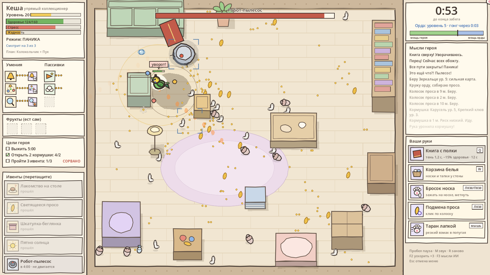

# Попугай наоборот

Vampire Survivors наоборот: игровой ИИ — волнистый попугай Кеша — сам бегает по комнате, клюёт носки и выбирает умения, а вы играете за орду и кошачью лапку. Ваша цель — поймать Кешу, пока он не сломал робота-пылесоса и не улетел.

*A reverse Vampire Survivors: the AI budgie runs the survivor build, you control the horde and a cat paw.*

**Играть в браузере:** https://wtoday92-commits.github.io/popugay-naoborot/

Godot 4.7.1, GDScript. Вся графика рисуется кодом, звук синтезируется на лету.



## Управление

| Что | Как |
|---|---|
| Рогатка | зажать ЛКМ на носке или тапке, оттянуть лапку назад и отпустить. Откат 3 с |
| Таран (с 0:20) | резкий рывок мышью в попугая |
| Подмена проса | ЛКМ по крупному колоску: капкан, тухлое, яйцо, снаряд |
| Книга с полки (с 2:00) | Q: тень, потом удар по площади |
| Клетка (с 3:00) | W: тень 2 с ползёт за лапкой, потом клетка накрывает попугая |
| Очередь ивентов | перетаскивать в левой полосе, пока ивент не объявлен |
| Пауза, звук, заново | Пробел, M, R |
| Ускорить ×3, мысли ИИ | F2, F3 |

## Как устроен забег

- Пять минут. На 4:00 просыпается робот-пылесос: попугай выбирается из комнаты, только сломав его. Комната каждый раз другая.
- Попугай — ИИ с тремя слотами внимания, полями опасности и интереса, режимами (фарм, охота, ивент, отход, паника), жадностью и стрессом. На каждом уровне он выбирает умение из трёх карт, вы можете запретить одну.
- Между забегами Кеша учится: помнит, что его било и что лучше заходило, и меняет план.

## Мета

1. **Исследования.** Первые 6 инструментов (подмена проса, книга, клетка, запрет умения, 3-й и 4-й ивенты) покупаются за перья, по ярусам.
2. **Штаб.** Открывается после исследований. У каждого из 5 умений игрока 3 ветки по 7 узлов: корень, два боковых, ключевая пассивка, два боковых, вершина. До ключевого узла и вершины ведут два пути. Ключевые узлы сначала надо заслужить (например, попасть носком 40 раз или продержать Кешу в клетке 30 с). Перед забегом выбираются 1–2 усиленных умения: работают только их деревья. Деревья, вкладка волн и второй слот усиления открываются постепенно.
3. **Волны.** В штабе можно расставить состав орды на каждые 30 секунд до пылесоса: носочный вал, тапочный марш, клубочный рой, брызгалки, затишье.
4. **Попугай** сам тратит просо на 11 улучшений, которые открываются этапами, получает награды за достижения и новые умения (Крик за просо, Искру за достижение «Пылесосный мастер»), выбирает 2 квеста из 6.

## Запуск из исходников

1. Установите [Godot 4.7.1](https://godotengine.org/download).
2. «Импорт» → `project.godot`, затем F5.

## Проверка без графики

```
python tools/balance.py nobot 16      # без игрока
python tools/balance.py mid 16        # средний игрок
python tools/progression.py 40 6      # 6 серий по 40 забегов с обучением и метой
```

Флаги одиночного запуска (после `--`): `--sim --nobot`, `--midbot`, `--fullbot`, `--prog`, `--learn`, `--selftest`, `--unlockall`, `--enh=throw,ram` (все узлы штаба куплены, эти деревья усилены), `--waves=socks,calm,...`. Итоги прогонов — в [docs/balance_report.md](docs/balance_report.md).

Сохранение и журналы боёв: `%APPDATA%/Godot/app_userdata/Попугай наоборот/` (в браузере — хранилище сайта).
